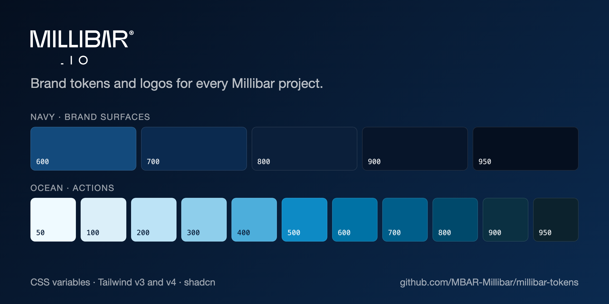

# @millibar/tokens

[](https://github.com/MBAR-Millibar/millibar-tokens/actions/workflows/checks.yml)
[](https://github.com/MBAR-Millibar/millibar-tokens/releases/latest)
[](#use)
[](#use)



Millibar brand tokens and logo files, shared by every Millibar project (app.millibar.io, instructors, centers, divers, Millibar Nitrox, Academy).

- **Navy** for brand surfaces: headers, hero sections, CTA bands, footers, dark mode. Main tone `navy-800` `#0b1f3a`; gradient `#07152a → #0b2a4f → #134a7c`.
- **Ocean** for actions: buttons, links, focus. Primary `ocean-600` `#0072a5`.

`tokens.json` is the single source. Edit it, run `npm run build`, commit `dist/`, then tag a new version.

## Install

```bash
npm install https://github.com/MBAR-Millibar/millibar-tokens/archive/refs/tags/v1.1.0.tar.gz
# or: pnpm add https://github.com/MBAR-Millibar/millibar-tokens/archive/refs/tags/v1.1.0.tar.gz
```

Pin a tag so a project only changes colour when you bump it. Each tag has a [release](https://github.com/MBAR-Millibar/millibar-tokens/releases) listing its changes.

**Don't install with `github:MBAR-Millibar/millibar-tokens#…`.** npm writes that into the lockfile as a `git+ssh://` URL, and deploy servers (Forge) only have a deploy key for their own repo, so `npm ci` fails and no assets get built ("Vite manifest not found"). The release tarball above is plain HTTPS and needs no key. After installing, check that `package-lock.json` has no `git+ssh`.

## Use

| You have | Import |
| --- | --- |
| Tailwind v4 + shadcn (Next.js landing sites) | `@import '@millibar/tokens/shadcn.css';` and `@import '@millibar/tokens/tailwind.css';` in `globals.css`, after `tailwindcss` |
| Tailwind v3 + shadcn (Millibar Nitrox) | `@import '@millibar/tokens/shadcn-hsl.css';` and `presets: [require('@millibar/tokens/tailwind-preset')]` in `tailwind.config` |
| Tailwind v4 without shadcn (Academy) | `@import '@millibar/tokens/tailwind.css';` |
| Plain CSS / Filament (app.millibar.io) | `@import '@millibar/tokens/tokens.css';` then use `var(--mbar-navy-800)`, `var(--mbar-gradient)` |

## What you get

- `tokens.css`: `--mbar-navy-{600…950}`, `--mbar-ocean-{50…950}`, `--mbar-logo`, `--mbar-gradient`, `--mbar-gradient-deep`.
- `tailwind.css` (v4): `navy-*`, `ocean-*` and `mbar-logo` colours; `bg-mbar-gradient` and `bg-mbar-gradient-deep` utilities.
- `shadcn.css` / `shadcn-hsl.css`: the shadcn variables (`--background`, `--primary`, …) for light and `.dark`, in hex (v4) or HSL triplets (v3).
- `tailwind-preset.cjs` (v3): the same colours and gradients.

Since v1.1.0, the Design Kit foundations (MD-8). Every name carries `mbar`, so nothing replaces a project's own defaults:

- Fonts: Geist for text, Geist Mono for labels and figures. The package names them; each project still loads them (`next/font` `Geist` / `Geist_Mono`, or Google Fonts).
  - `tokens.css`: `--mbar-font-sans`, `--mbar-font-mono`, `--mbar-space-{1,2,3,4,6,8,12,16,24}`, `--mbar-radius-{sm,md,lg,full}`, and `.mbar-text-{display,h1,h2,h3,body-lg,body,small,button,label,readout,code}` classes.
  - `tailwind.css` (v4) and the v3 preset: `font-mbar-sans`, `font-mbar-mono`, `text-mbar-*` (size, line height, weight, tracking), `rounded-mbar-*`. Spacing follows Tailwind's 4px steps, so there are no extra spacing utilities.
- Logos in `logos/`: `millibar-{logo,lockup,wordmark,symbol}` in `-navy` (#192340, for light grounds), `-white` (for navy and photography), `-black`, and a plain file that takes `currentColor` when inlined. Import as `@millibar/tokens/logos/millibar-lockup-navy.svg`.

The type scale, spacing and radius are proposed in the Design Kit and change only by a version bump. Usage rules (clear space, minimum sizes, voice, the open Bujnowski concept directions) live in the Millibar Design Kit (MD-8).

## Contributing

Issues and pull requests are welcome. See [CONTRIBUTING.md](CONTRIBUTING.md), the [Code of Conduct](CODE_OF_CONDUCT.md) and, for vulnerabilities, [SECURITY.md](SECURITY.md).

## License

© 2026 Millibar. All rights reserved. The package is published so Millibar's own projects can install it; it isn't licensed for use elsewhere. The Millibar name and logos are trademarks of Millibar.
